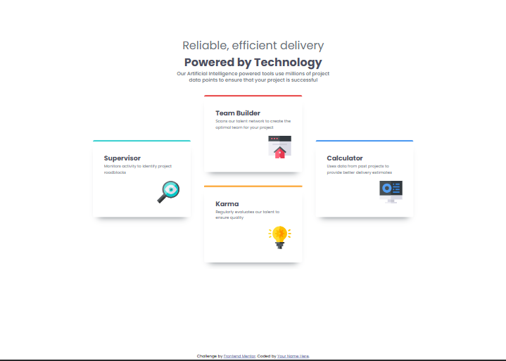

# Frontend Mentor - Four card feature section solution

This is a solution to the [Four card feature section challenge on Frontend Mentor](https://www.frontendmentor.io/challenges/four-card-feature-section-weK1eFYK). Frontend Mentor challenges help you improve your coding skills by building realistic projects.

## Table of contents

- [Overview](#overview)
  - [The challenge](#the-challenge)
  - [Screenshot](#screenshot)
  - [Links](#links)
- [My process](#my-process)
  - [Built with](#built-with)
  - [What I learned](#what-i-learned)
  - [Continued development](#continued-development)
- [Author](#author)

## Overview

### The challenge

Users should be able to:

- View the optimal layout for the site depending on their device's screen size

### Screenshot



### Links

- Solution URL: [https://camagu-mgadle.github.io/Four-card-feature-section](https://camagu-mgadle.github.io/Four-card-feature-section/)
- Live Site URL: [https://fourwayscard.netlify.app](https://fourwayscard.netlify.app/)

## My process

### Built with

- For markup used Semantic HTML5 structure:
  - main
    - article
  - footer
- Mobile-first workflow
- Flexbox Model
- CSS Grid
- Google fonts:
  - Family: [Poppins](https://fonts.google.com/specimen/Poppins)
    - Weights: 200, 400, 600
- CSS custom properties

### What I learned

- Used an article element as a container instead of a simple div.

- For desktop design I used the grid template on the card container:

  ```css
  card-container {
    display: grid;
    grid-template-columns: repeat(3, 1fr);
    grid-template-rows: repeat(2, 1fr);
    overflow-y: hidden;
    align-items: center;
  }

  .team-builder {
    grid-column: 2;
    grid-row: 1 / span 1;
  }
  ```

- Used media query for breakpoints:

  ```css
  .main-container {
    border-radius: 0.625rem;
    max-width: 19.765rem;
    min-height: 100vh;
    margin-top: 2.5rem;
    display: flex;
    flex-direction: column;
    align-items: center;
  }

  @media (min-width: 48em) {
    .main-container {
      border-radius: 0.625rem;
      max-width: 19.765rem;
      min-height: 100vh;
      margin-top: 2.5rem;
      display: flex;
      flex-direction: column;
      align-items: center;
    }
  }
  ```

### Continued development

- Learn more about CSS Grid layout.
  - grid-column
  - grid-row
- For accessibility learn more about css attributes.
- Understanding CSS Frameworks.

## Author

- Website - [Camagu](https://mgadleca.netlify.app)
- Frontend Mentor - [@camagu](https://www.frontendmentor.io/profile/camagu)
- LinkedIn - [@camagu](https://www.linkedin.com/in/camagu-mgadle)
